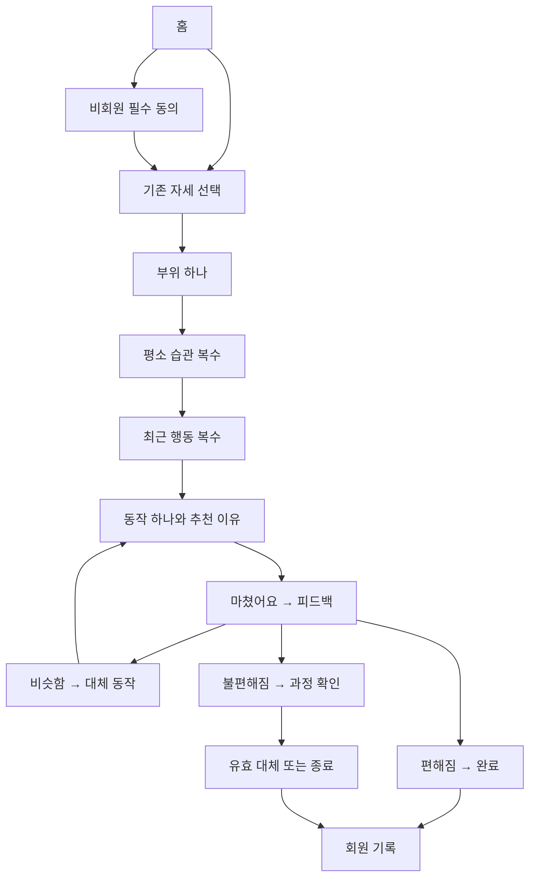

# 직꼿 UIUX 통합 점검 · 2026-10-13

홈부터 루틴·기록·계정까지 주요 화면 15개가 마련되어 있다. 이전 채팅의 실제 홈·자세·부위 시안과 이번 채팅의 최종 수정본을 모았고, 빠진 상태 13개를 같은 디자인으로 채웠다. 통합 검토본에는 총 28개 화면/상태가 있다.

이 자료는 디자인과 동작 흐름을 검토하는 시안이다. 서버 로그인, SMS, 실회원 기록 저장, 운영 배포를 완료한 프로그램은 아니다. 통합 검토본의 화면 선택기와 ‘회원 시안’ 체크박스는 검토 도구이며 실제 제품에는 넣지 않는다.

## 화면 대조표

| 번호 | 화면/상태 | 근거 | 이번 통합 결과 | 실제 구현에서 할 일 |
|---|---|---|---|---|
| 01 | 홈 | 이전 채팅 jikkot-home.html | 캐릭터·문구·메뉴 유지, 최종 워드마크 적용 | 회원 여부별 버튼·로그아웃 연결 |
| 02 | 자세 선택 | 이전 채팅 jikkot-posture-copy.html | “지금 어떤 상태인가요?” 문구 유지, 카드 픽토그램 제거 | 선택 자세 저장, 새 루틴 시작 시 초기화 |
| 03 | 불편한 부위 선택 | 이전 채팅 jikkot-body-compact.html | 작은 스케치 인체, 5부위 호버·탭·라벨·발광 유지 | 실제 선택 ID와 연결, 키보드 선택 지원 |
| 04 | 평소 생활 습관 | 이번 채팅 최종본 | 글자 카드, 복수 선택, 부위는 표시만 | 질문 ID와 기존 추천 데이터 연결 |
| 05 | 최근 행동 | 이번 채팅 최종본 | 글자 카드, 복수 선택, ‘내 루틴 보기’ | 최근 행동 제출→추천 호출 |
| 06 | 추천 동작 | 이번 채팅 최종본 | 이유·원본 그림·설명·‘마쳤어요’ | 실제 추천 스냅샷 표시, 원본 그림 확대 |
| 07 | 피드백 | 이번 채팅 최종본 | 세 선택을 누르면 바로 분기 | 중복 제출 방지, 회원 기록 자동 저장 |
| 08 | 완료 | 이번 채팅 최종본 | 편해졌어요 결과·요약·홈·기록 | 비회원 문구/버튼 차등 |
| 09 | 내 기록 | 이번 채팅 최종본 | 부위별 묶음·상세 펼침 | 실제 날짜·답변·동작·피드백 연결 |
| 10 | 불편했던 과정 | 이번 채팅 최종본 | “어느 과정에서 불편했나요?”만 제목 유지 | 동작별 질문 데이터로 연결 |
| 11 | 루틴 종료 | 이번 채팅 최종본 | 개선을 단정하지 않는 종료 요약 | 실제 피드백별 내용, 회원/비회원 차등 |
| 12 | 로그인 | 이번 채팅 최종본 | 아이디/비밀번호·카카오·네이버·Google | 실제 인증·제공자별 연결 상태 |
| 13 | 회원가입 | 이번 채팅 최종본 | 아이디·비번 확인·휴대폰·정보용 이메일·필수 동의 | 유효성·아이디 중복·휴대폰 인증·동의 저장 |
| 14 | 가입 완료 | 이번 채팅 최종본 | 환영·회원 기능·루틴 시작 | 실제 가입 완료 후만 표시 |
| 15 | 다른 동작 추천 | 이번 채팅 최종본 | 이전 답변 유지, 다른 동작 1개, 마쳤어요/종료 | 승인된 대체 규칙으로 연결 |
| 16 | 비회원 첫 이용 동의 | 추가 보완 | 의료서비스 아님 필수 확인만 | 동의 버전·거절 상태 처리 |
| 17 | 소셜 첫 가입 동의 | 추가 보완 | 두 필수 동의와 거절 | 신규 소셜 사용자 온보딩 연결 |
| 18 | 휴대폰 인증 | 추가 보완 | 코드 입력·재발송·오류·가입 화면 복귀 | 실제 SMS/PASS 공급자, 만료·횟수 제한 |
| 19 | 비회원 하루 제한 | 추가 보완 | 오늘 체험 소진 안내·로그인·홈 | 한국시간 날짜·실제 추천 표시 시 소진 |
| 20 | 기록 없음 | 추가 보완 | 빈 화면·첫 루틴 시작 | 서버 결과가 빈 경우 표시 |
| 21 | 대체 동작 없음 | 추가 보완 | 추가 동작 없음·종료·회원 기록 | 현재/방문 동작 제외, 후보 없으면 종료 |
| 22 | 연결 오류 | 추가 보완 | 답변 유지·재시도·홈 | API 실패 유형과 연결 |
| 23 | 스트레칭·쇼핑 준비 중 | 추가 보완 | 공통 준비 안내 | 실제 기능·결제는 활성화하지 않음 |
| 24 | 추천 준비 | 추가 보완 | 요청 처리 중 화면 | 요청 중 자동 표시·성공/실패 자동 이동 |
| 25 | 필수 동의 거절 | 추가 보완 | 서비스 차단·동의 재확인·홈 | 직전 가입/비회원 동의로 복귀 |
| 26 | 회원 전용 접근 | 추가 보완 | 기록 기능 로그인 안내 | 직접 URL·뒤로 가기에서도 권한 체크 |
| 27 | 선택 자세 콘텐츠 없음 | 추가 보완 | 해당 자세 준비 중·앉기 이용·홈 | 자세가 맞지 않는 동작을 조용히 내보내지 않기 |
| 28 | 기록 저장 실패 | 추가 보완 | 답변/피드백 유지·저장 재시도 | 같은 제출 ID로 중복 없이 재시도 |

로그인 실패·비밀번호 불일치·동의 미선택·휴대폰 코드 오류는 별도 페이지를 늘리지 않고 해당 입력 화면 안에서 표시한다. 원본 그림 확대와 약관 상세는 같은 화면 위에 띄우는 상세 보기다.

## 확정 기준과 정리한 충돌

- 브랜드: Jikkot / 직꼿. 업로드한 **Jikkot English wordmark-3(1).png**를 최종 네이밍 로고로 사용한다. 일반 텍스트 jikkot.이나 초기 로고로 대체하지 않는다. 로고 아래 별도의 “직꼿”은 넣지 않는다.
- 색상: 라이브 코랄 `#EF7564`, 딥 인디고 `#252A76`. 큰 배경은 밝고 조용하게, 선택 카드에는 연한 코랄을 쓴다.
- 글꼴: 한글 LINE Seed KR, 영문·숫자 Nunito. 두 글꼴 실제 파일과 라이선스를 포함했다.
- 선택 카드의 장식 픽토그램은 제거했다. 선택 체크·이전·방향 같은 기능 표시와 Google 실제 로고는 별개다.
- 부위는 머리·목·어깨·등·허리 5개뿐이다. 세부 부위 재질문을 만들지 않는다.
- 인체는 이전 채팅 마지막 작은 스케치 버전이다. 비율을 유지하며 전체 모형을 약 16% 줄인 결과를 보존했다. 부위 이름은 호버/선택/키보드 초점 시에만 보인다. ‘뒷모습’은 표시하지 않는다.
- 자세 선택은 처음의 기존 화면 하나를 재사용한다. 이 채팅에서 중복 제작 후 제외한 `jikkot-posture-screen.html`은 최종 자료에서 제외했다.
- 이후 화면의 ‘선택한 부위’는 고정 표시다. 이를 바꾸려면 이전 버튼으로 부위 선택 단계까지 돌아간다.
- 추천 화면에는 ‘동작 시작하기’가 없다. 안내를 보고 움직인 뒤 ‘마쳤어요’ 하나를 누른다.
- 피드백은 선택 즉시 제출/분기한다. 별도의 ‘다음/제출’ 버튼을 늘리지 않는다.
- 불편 확인에서 삭제 요청한 “지금은 동작을 멈춰주세요”, “더 불편해진 동작을 계속할 필요는 없어요”를 복구하지 않는다. 제목은 “어느 과정에서 불편했나요?”다.
- Google 문구는 “Google로 계속하기”이며 공식 컬러 G 로고를 사용한다.
- 시안의 질문 문구와 예시 추천은 표현·구성 검토용이었다. 실제 콘텐츠 ID·분기·일반 항목 목록은 기존 5부위 명세가 기준이다. 임의로 질문 항목을 빼거나 추천을 바꾸지 않는다. 통합 검토본은 기존 SPEC의 입력 문구/ID를 다시 사용했다.
- 단계 표시는 자세 선택과 추천용 세 질문을 구분한다. 추천용 세 질문은 부위→습관→최근 행동이다. 이전 4칸과 이번 3칸이 혼재하지 않게 추천 질문에 공통 3칸을 적용했다.
- 시안의 코랄 버튼 일부는 흰 글자였지만 읽기 쉬운 대비를 위해 통합본은 딥 인디고 글자를 사용한다. 코랄과 인디고 브랜드 색상은 유지한다.

## 사용자 흐름

회원/비회원 분기, 동의 거절, 하루 한도, 대체 동작 없음은 표의 상태별 조건을 따른다. 위 그림은 제품 흐름의 요약이며 구현 분기표를 대체하지 않는다.

## 디자인 밖에 남아 있는 실제 작업

| 작업 | 확인한 현재 상태 | 전달할 구현 방향 |
|---|---|---|
| 화면 실제 이동 | 개별 시안 버튼 대부분 안내만 표시 | 공통 상태/라우팅에 연결, 스텁 제거 |
| 폰트와 정적 자산 | 일부 시안의 글꼴 주소 오기·HTML마다 이미지 중복 | 첨부 자산을 self-host, 공통 컴포넌트화 |
| Firebase 로그인·소셜·휴대폰 | 시안은 미연결 | 기존 실제 구현/권한 재사용, 준비 상태를 성공으로 속이지 않기 |
| 기록·복원·비회원 제한 | 통합본은 메모리 시뮬레이션 | 서버 소유권·실패 재시도·기존 기록 유지 |
| 대체 추천 | 관찰한 `nextRecommendation`은 pattern/changes 인수를 사용하지 않음 | 임의로 몸 부위 전체 후보로 순환하지 않게 승인된 대체 데이터 확인 |
| 자세별 콘텐츠 | 읽은 현재 데이터의 11동작은 모두 앉기 | 서기/눕기 콘텐츠가 없으면 준비 안내. 승인 없이 자세를 변형하지 않기 |
| 배포 위치 | 읽은 체크아웃은 GitHub ehdgus554/jikkot, vinext + Cloudflare Workers 구성 | 실행할 때 최신 설정 재확인, 기존 Worker/도메인으로 배포 |
| 운영 동의 정책 | 읽은 체크아웃은 draft-v1·reviewedForLaunch=false·보유기간 미정 | 실제 운영 문서로 채우기, 검토됐다고 플래그만 조작하지 않기 |

마지막 두 항목의 환경 정보는 2026-10-13에 접근한 로컬 체크아웃에서 확인한 내용이다. 운영 서버의 실시간 상태를 확인한 결과는 아니다. Codex가 실행할 때 최신 저장소·현재 배포 설정을 다시 확인해야 한다.

## 검증한 범위

- 28개 화면/상태 × 320·390·736·1024px = 112개 렌더 확인. 가로 넘침·JavaScript 실행 오류 없음.
- 회원: 자세→등→습관→최근 행동→7번 동작→비슷함→8번 예시→편해짐→기록. 두 동작의 피드백이 구분되어 표시됨.
- 비회원: 필수 동의→추천→완료→다시 시작→하루 제한. 회원 기록 확인 버튼이 나오지 않음.
- ‘잘 모르겠어요’ 선택 시 일반 항목이 해제됨.
- 실제 LINE Seed KR 글꼴 로딩 확인.
- 로고·인체·11개 동작 원본 파일을 자료에 포함. 원본 동작 PNG를 편집하거나 재생성하지 않음.

통합 검토본의 7→8 대체 연결은 디자인을 볼 수 있는 예시다. 실제 대체 추천의 임상적 타당성이나 최종 제품 규칙을 검증한 결과가 아니다. SMS·실제 OAuth·서버 기록·운영 사이트 반영은 이 검증 범위에 포함되지 않는다.
